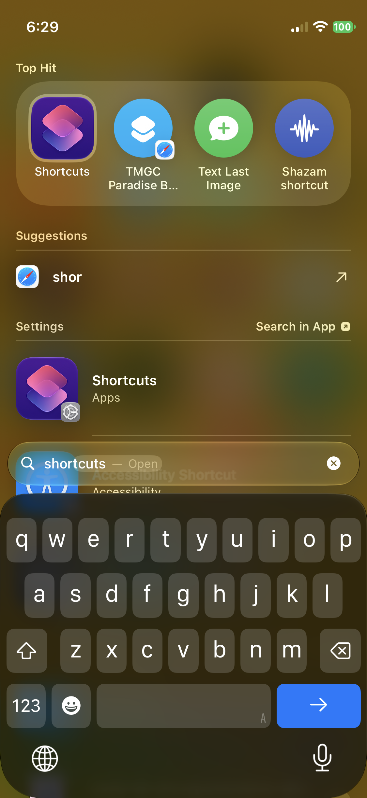
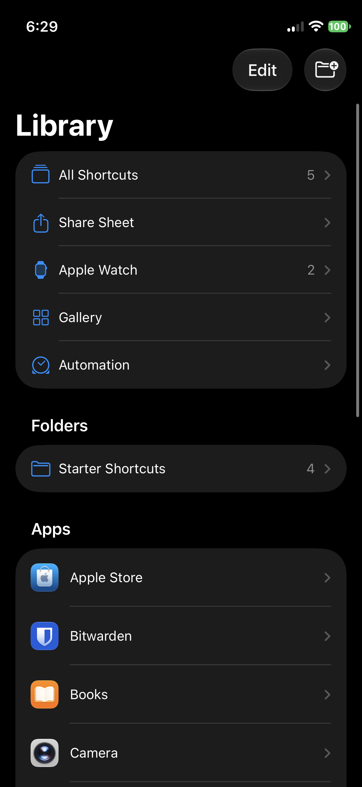
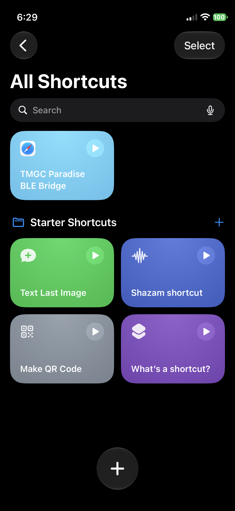
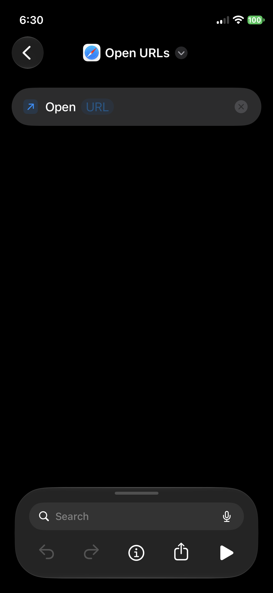
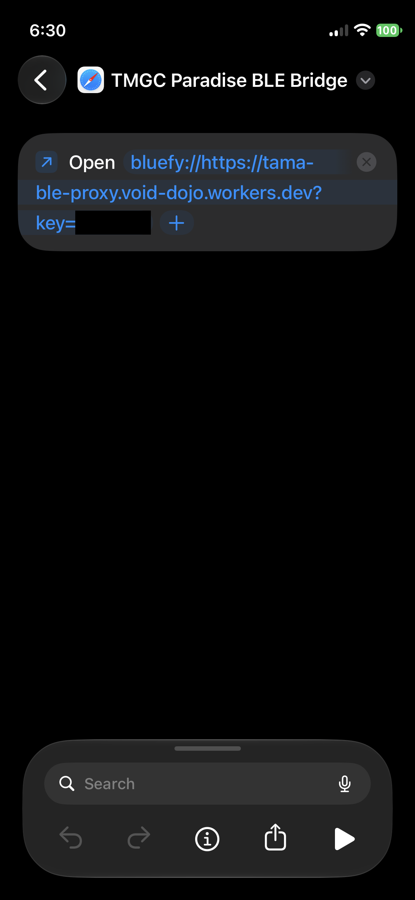

# Tamagotchi Paradise Wireless Adaptor

A Bluetooth transparent serial bridge for **Tamagotchi Paradise**. It lets PC and mobile tools such as **TamaHome** (https://bbamorachi.us/tamahome-toolkit-windows/), **BBSite** (https://tools.bbamorachi.us/), and similar UART-based apps talk to the device wirelessly over Bluetooth instead of a wired USB–UART cable.

Built around an **ESP-32S** module, the adaptor sits between the host and Tamagotchi Paradise and forwards bytes in both directions at 460800 baud.

## Why this exists

Official and community tools expect a serial (UART / Web Serial) connection. That works well on desktop with a cable, but:

- Many platforms only expose Bluetooth reliably (especially mobile)
- Some browsers have Web Bluetooth but not Web Serial
- A small wireless bridge is easier to leave connected to the Tamagotchi

This project provides the hardware, firmware, and (for web tools) a BLE Web Serial shim so the same tools can work across **Windows, macOS, Linux, Android, and iOS**.

## How it works

```text
Host app (TamaHome / BBSite / …)
        │
        │  Bluetooth Classic SPP  or  BLE
        ▼
   ESP-32S bridge board
        │
        │  UART @ 460800 (GPIO16 RX / GPIO17 TX)
        ▼
  Tamagotchi Paradise
```

A mode switch on the board selects the radio link:

| Mode                               | Switch            | Typical use                          |
| ---------------------------------- | ----------------- | ------------------------------------ |
| **SPP** (Classic Bluetooth serial) | SW open           | Desktop apps, Chrome, Android Chrome |
| **BLE**                            | SW shorted to GND | BLE only for iOS Bluefy BBSite       |

Device names:

- SPP: `Tamagotchi Paradise Bridge SPP`
- BLE: `Tamagotchi Paradise Bridge`

## Repository layout

| Path                                             | Contents                                                                                 |
| ------------------------------------------------ | ---------------------------------------------------------------------------------------- |
| [`firmware/tama_bridge/`](firmware/tama_bridge/) | Arduino / ESP32 firmware (SPP + BLE bridge)                                              |
| [`hardware/`](hardware/)                         | ESP-32S PCB docs, KiCad project, Gerber / BOM / CPL                                      |
| [`worker/`](worker/)                             | Cloudflare Worker that proxies web tools and injects a BLE Web Serial shim               |
| [`tools/ble-loopback/`](tools/ble-loopback/)     | Optional local BLE throughput / shim test pages (just a dev tools for protocol analysis) |

To make the entire wireless adaptor works, you also need a adaptor case with rechargeable LiPo battery circuit; You can reference to my another repo:　https://github.com/sawaYch/tamagotchi-paradise-uart-adaptor/tree/main/models/wireless

## Firmware

Sketch: [`firmware/tama_bridge/tama_bridge.ino`](firmware/tama_bridge/tama_bridge.ino)

- Arduino board: **ESP32 Dev Module** (4 MB flash is enough)
- Pins: UART2 on **IO16** (RX from Tama), **IO17** (TX to Tama); mode on **IO4**; status LED on **IO2**
- Build options in `build_opt.h` raise NimBLE buffers / MTU for better BLE throughput

Flash with an external USB–UART (CH340 / CP2102): hold **BOOT**, press **RST**, release **BOOT**, then upload. See [`hardware/README.md`](hardware/README.md).

## Hardware

Custom PCB based on ESP-32S (~20 × 37.6 mm), 3.3 V powered, with pads for:

- Battery / 3.3 V power
- Programming UART
- Tamagotchi UART
- Mode switch

Full pad map, BOM notes, and Gerber path: [`hardware/README.md`](hardware/README.md)  
KiCad project: [`hardware/kicad/tama_bridge_esp32s/`](hardware/kicad/tama_bridge_esp32s/)

## Web tools (BLE shim)

Desktop Web Serial apps usually need Classic serial or SPP. On platforms where only BLE is available, [`worker/`](worker/) runs a Cloudflare Worker that:

1. Proxies the upstream tools site
2. Injects [`worker/public/__tama/shim.js`](worker/public/__tama/shim.js), which implements `navigator.serial` on top of Web Bluetooth NUS

That lets browser-based tools reuse their existing Web Serial code path over BLE.

## Platform notes

| Platform                | Typical path                                                                          |
| ----------------------- | ------------------------------------------------------------------------------------- |
| Windows / macOS / Linux | SPP as a Bluetooth serial port (Both work with TamaHome desktop app & Tama Web Tools) |
| Android                 | SPP via Chrome in Desktop site mode                                                   |
| iOS                     | BLE via BLE supported web browser Bluefy                                              |

Exact app support depends on each tool (TamaHome, BBSite, etc.). The adaptor only provides a transparent UART bridge.

## Extra Setup on iOS

Since iOS only support BLE, it does not create a serial COM port in web browser like Chrome. You need to install Bluefy (free on iOS App Store):

- https://bluefy.app/
- https://apps.apple.com/us/app/bluefy-web-ble-browser/id1492822055

### Highly suggest you to create a iOS ShortCut to visit the proxied Tamagotchi Web Tools:

1. Open "Shortcuts"  
   

2. Click "All Shortcuts"  
   

3. Click "+" sign to add new shortcut  
   

4. Select "Open URL" (Not Open App)  
   

5. Fill-in url "bluefy://{your hosted proxy website for tmgc web tools}"  
   

6. Done. Now you click the newly added shortcut on Home Screen should open Bluefy with TMGC Web Tools. Toggle the wireless adaptor to BLE mode, and the on the web tools click "Connect USB", you should see the BLE adaptor device. Connect to it, then plug the wireless adaptor to your Tamagotchi Paradise, you should be able to transfer Gift, Lab items, etc.

## License

This project is licensed under the [MIT License](LICENSE).
